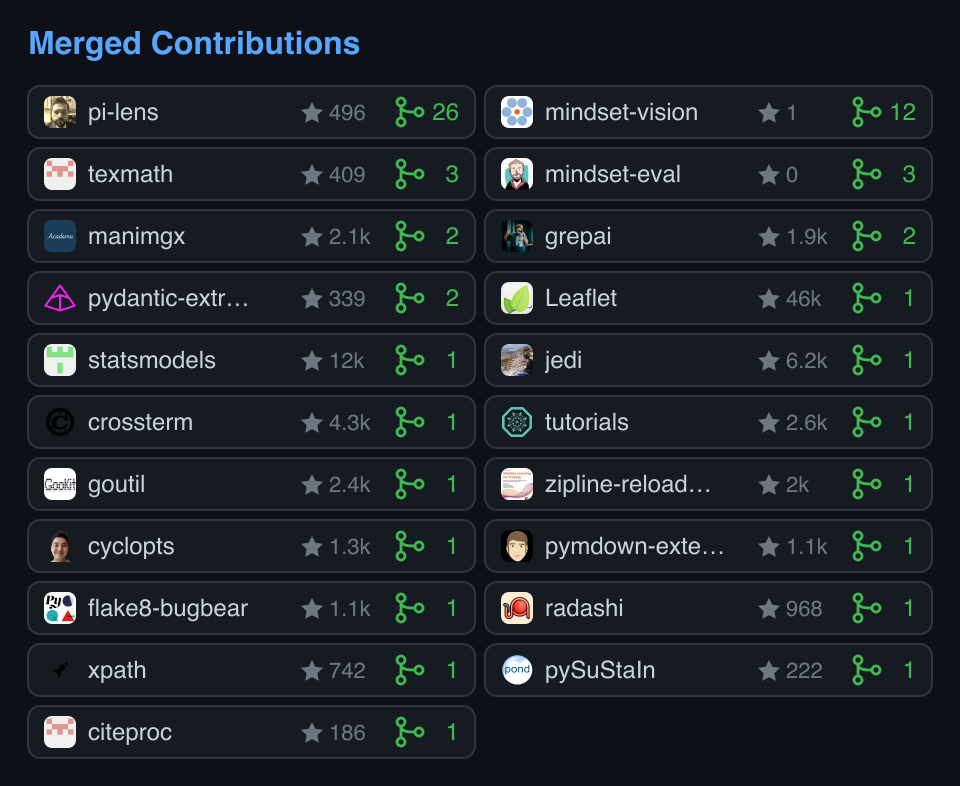

# Merged Contributions

I built this to show merged public pull requests outside my own repositories. Repositories are sorted by merged count, then stars. The action has no runtime dependencies. The SVGs embed their avatars, so displaying a card needs no external image requests.



A 14-second [demo](assets/demo.mp4) shows the wide and narrow cards.

## Usage

Save this as `.github/workflows/merged-card.yml` in your profile repository.

```yaml
name: Merged contributions
on:
  workflow_dispatch:
  schedule:
    - cron: "17 3 * * *"
permissions:
  contents: write
jobs:
  card:
    runs-on: ubuntu-latest
    steps:
      - uses: actions/checkout@v4
      - uses: Don-Yin/merged-card@main
        with:
          user: ${{ github.repository_owner }}
      - run: |
          git add merged-card-wide.svg merged-card-narrow.svg
          git diff --cached --quiet && exit 0
          git -c user.name="$GITHUB_ACTOR" -c user.email="$GITHUB_ACTOR@users.noreply.github.com" commit -m "Update merged contributions"
          git push
```

Add this to your README; the narrow card includes `owner/repo`, while the wide card uses repository names:

```html
<picture>
  <source media="(max-width: 600px)" srcset="merged-card-narrow.svg">
  
</picture>
```

## Inputs

| Input | Default | Meaning |
| --- | --- | --- |
| `user` | required | GitHub username |
| `token` | `${{ github.token }}` | Token for the GitHub GraphQL API; public access is sufficient |

Outputs `wide` and `narrow` point to `merged-card-wide.svg` and `merged-card-narrow.svg` in the workspace. All pages are fetched; private repositories and repositories owned by `user` are excluded. API or avatar failures stop the action rather than publish an incomplete card.

Local use: `INPUT_USER=Don-Yin INPUT_TOKEN="$(gh auth token)" node index.mjs` (Node 24+). Tests: `npm test`.

MIT licensed.
