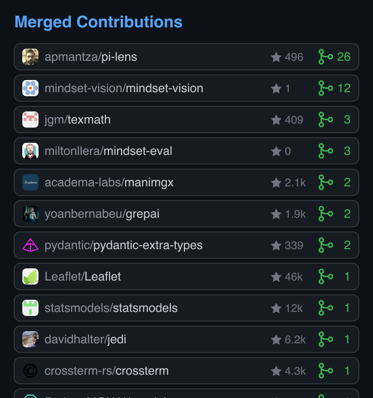

<div align="center">

# github-pr-stats-cards

Cards for the pull requests you got merged into other people's repositories.

[](https://github.com/Don-Yin/github-pr-stats-cards/actions/workflows/ci.yml)
[](https://github.com/Don-Yin/github-pr-stats-cards/releases)
[](LICENSE)

&nbsp;&nbsp;

<sub>Wide card on desktop, narrow card on phones · [14 s demo](assets/demo.mp4)</sub>

</div>

Sorted by merged PRs, then stars. Private and your own repositories are skipped. Avatars are embedded, so the SVGs load with no extra requests.

## Usage

`.github/workflows/pr-stats-cards.yml` in your profile repository:

```yaml
name: PR stats cards
on:
  workflow_dispatch:
  schedule:
    - cron: "17 3 * * *"
permissions:
  contents: write
jobs:
  cards:
    runs-on: ubuntu-latest
    steps:
      - uses: actions/checkout@v4
      - uses: Don-Yin/github-pr-stats-cards@v1
        with:
          user: ${{ github.repository_owner }}
      - run: |
          git add pr-stats-*.svg
          git diff --cached --quiet && exit 0
          git -c user.name="$GITHUB_ACTOR" -c user.email="$GITHUB_ACTOR@users.noreply.github.com" commit -m "Update PR stats cards"
          git push
```

Then in your README:

```html
<picture>
  <source media="(max-width: 600px)" srcset="pr-stats-narrow.svg">
  
</picture>
```

| Input | Default | |
| --- | --- | --- |
| `user` | required | GitHub username |
| `token` | `github.token` | Public read access is enough |

Run locally: `INPUT_USER=you INPUT_TOKEN="$(gh auth token)" node index.mjs`
