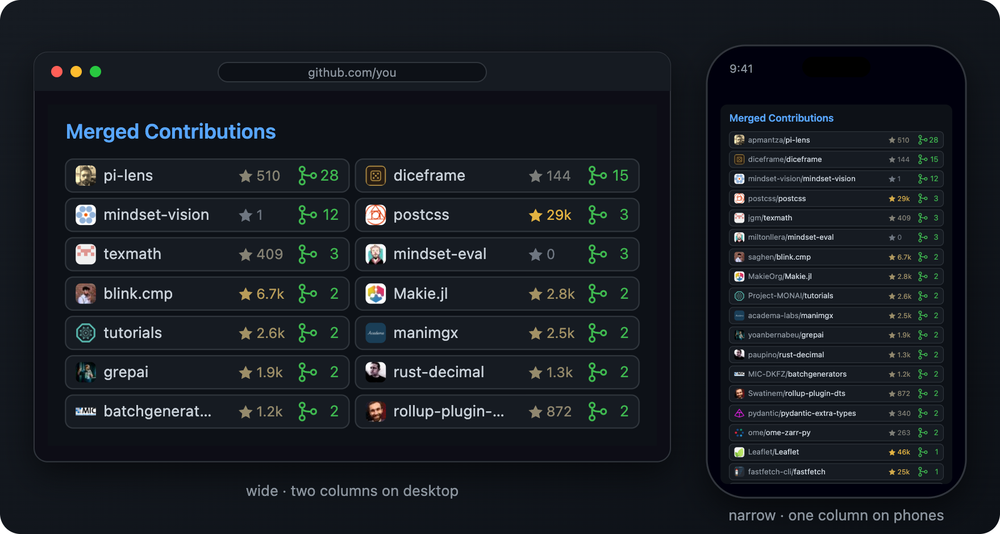
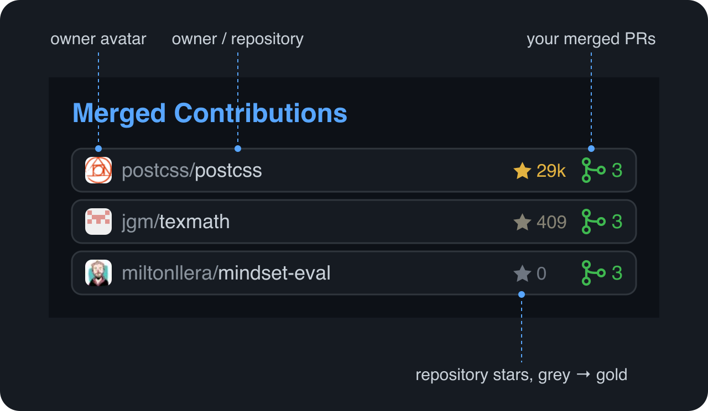

<div align="center">

# github-pr-stats-cards

Show the pull requests you got merged into other people's repositories.

[](https://github.com/marketplace/actions/github-pr-stats-cards)
[](https://github.com/Don-Yin/github-pr-stats-cards/actions/workflows/ci.yml)
[](https://github.com/Don-Yin/github-pr-stats-cards/releases)
[](LICENSE)



<sub>[14 s demo](assets/demo.mp4) · [live on my profile](https://github.com/Don-Yin)</sub>

</div>

## Features

- **Other people's repositories only.** Private repositories and your own are skipped, so the card shows outside contributions.
- **Fits every screen.** A two-column card for desktop and a one-column card for phones, switched by `<picture>`.
- **Self-contained SVGs.** Avatars are embedded, so the cards load with no extra requests.
- **Runs in your own workflow.** No hosted service and no shared rate limit; the default workflow token is enough.

## Reading the card



Repositories are sorted by your merged pull requests, then by stars. Star colour runs from grey to gold on a log scale across the repositories on your card.

## Usage

`.github/workflows/pr-stats-cards.yml` in your profile repository:

```yaml
name: PR stats cards
on:
  workflow_dispatch:
  schedule:
    - cron: "17 3 * * *"
permissions:
  contents: write
jobs:
  cards:
    runs-on: ubuntu-latest
    steps:
      - uses: actions/checkout@v7
      - uses: Don-Yin/github-pr-stats-cards@v1
        with:
          user: ${{ github.repository_owner }}
      - run: |
          git add pr-stats-*.svg
          git diff --cached --quiet && exit 0
          git -c user.name="$GITHUB_ACTOR" -c user.email="$GITHUB_ACTOR@users.noreply.github.com" commit -m "Update PR stats cards"
          git push
```

Then in your README. The `<details>` block shows the top repositories and expands in place to the rest:

```html
<div align="center">
  <picture>
    <source media="(max-width: 600px)" srcset="pr-stats-narrow.svg">
    
  </picture>
  <details>
    <summary>See all repositories</summary>
    <picture>
      <source media="(max-width: 600px)" srcset="pr-stats-narrow-more.svg">
      
    </picture>
  </details>
</div>
```

To make the desktop card smaller, give both `` tags the same pixel width, such as `width="400"`. A percentage width also shrinks the phone card, which then no longer fills the screen.

| Input | Default | |
| --- | --- | --- |
| `user` | required | GitHub username |
| `token` | `github.token` | Public read access is enough |
| `limit` | `16` | Repositories on the main card; the rest go to the `-more` card. `0` puts every repository on the main card |

| Output | |
| --- | --- |
| `wide` | Path to the two-column SVG |
| `narrow` | Path to the one-column SVG |
| `wide-more`, `narrow-more` | The repositories past `limit`, without a title |

Run locally: `INPUT_USER=you INPUT_TOKEN="$(gh auth token)" node index.mjs`
